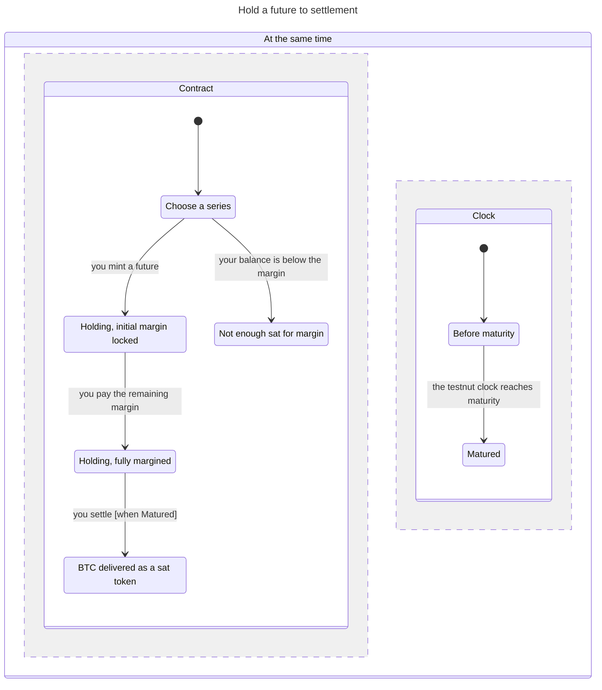

# Cashu futures verification

| Skill | What it checks | Tool |
| --- | --- | --- |
| [verify-futures-lifecycle](../../.claude/skills/verify-futures-lifecycle/SKILL.md) | The demo conserves sat through settlement, every series can mature, and the reserve token matches the balance | TLA+ / TLC, 37 states, plus `test/lifecycle.test.mjs` |

The model found three bugs in the testnut demo, now fixed:

1. Settlement credited the payout to the balance and also delivered it as a token, so the wallet showed it twice (a31e2b6).
2. The clock only ever reached the September maturity, so October futures could not settle (0adb016).
3. Swapping the reserve token unlinked it from the balance (8990166).

## Hold a future to settlement

Generated with pstack `/statechart` from [TradeFuture.tla](flows/trade-a-future/TradeFuture.tla) ([TLC report](flows/trade-a-future/report.md)). The contract and the clock are parallel regions. The chart hides swaps and early settle attempts, which leave the state unchanged.

